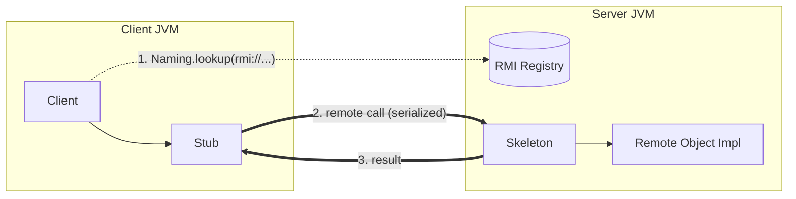
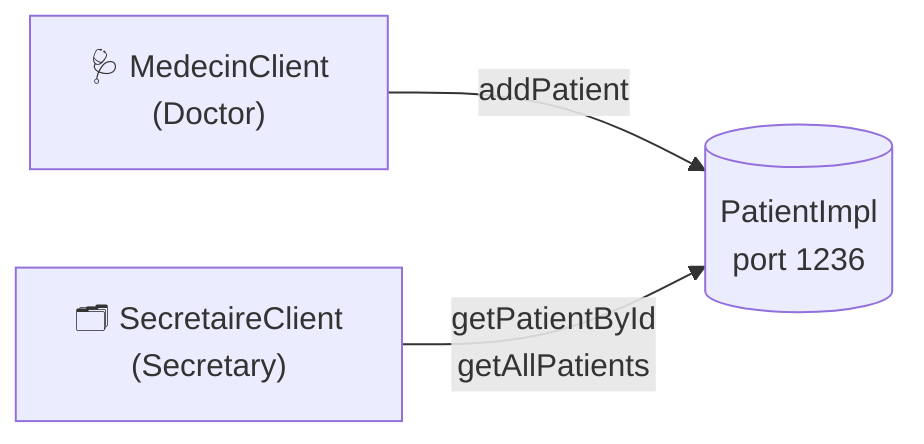
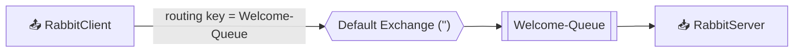
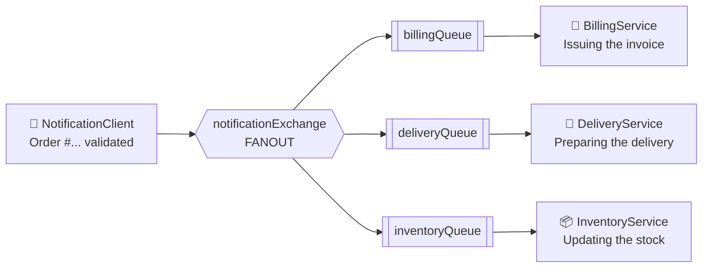
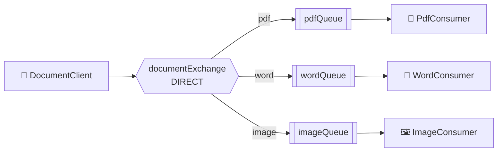
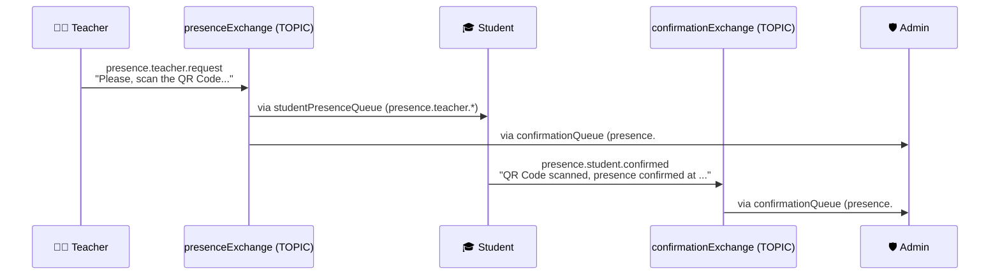

<div align="center">

# 🛰️ Middlewares Lab Journal

### *How do two programs talk when they don't even live in the same process?*

A hands-on journey through distributed systems in Java, from **remote method calls** with **Java RMI**
to **asynchronous messaging** with **RabbitMQ**.


**9 projects · 2 middleware paradigms · 4 exchange types · 1 goal: make distributed code feel simple**

</div>

---

## 📖 Table of Contents

- [The Big Picture](#-the-big-picture)
- [Part I: Java RMI, Calling Objects Across the Network](#-part-i-java-rmi--calling-objects-across-the-network)
  - [1. Welcome: Hello, Remote World](#1--welcome--hello-remote-world)
  - [2. Student Grade: Passing Parameters](#2--student-grade--passing-parameters)
  - [3. Bank: Stateful & Thread-Safe](#3--bank--stateful--thread-safe)
  - [4. Health Center: Many Clients, One Truth](#4--health-center--many-clients-one-truth)
  - [5. Hotel: Shipping Real Objects](#5--hotel--shipping-real-objects)
- [Part II: RabbitMQ, Talking Through a Broker](#-part-ii-rabbitmq--talking-through-a-broker)
  - [6. Welcome Rabbit: The Default Exchange](#6--welcome-rabbit--the-default-exchange)
  - [7. Notifications: Fanout Exchange](#7--notifications--fanout-exchange)
  - [8. Documents: Direct Exchange](#8--documents--direct-exchange)
  - [9. Attendance Tracking: Topic Exchange](#9--attendance-tracking--topic-exchange)
- [RMI vs RabbitMQ at a Glance](#%EF%B8%8F-rmi-vs-rabbitmq-at-a-glance)
- [Getting Started](#-getting-started)
- [Repository Layout](#-repository-layout)
- [What I Learned](#-what-i-learned)

---

## 🌍 The Big Picture

A **middleware** is the invisible glue between distributed applications. These labs explore its two big families:

| | 🔗 **Synchronous: Java RMI** | 📬 **Asynchronous: RabbitMQ** |
|---|---|---|
| **Mental model** | *"Call a method on an object that lives on another machine"* | *"Drop a letter in a post office and let it route it"* |
| **Coupling** | Client must know the server and wait for it | Producer and consumer never meet |
| **Communication** | Request ⇄ Response | Publish → Exchange → Queue → Consume |

The labs climb a ladder of difficulty: each project adds **one new idea** on top of the previous one.

---

## 🔗 Part I: Java RMI, Calling Objects Across the Network

Every RMI project follows the same proven architecture:



1. 📜 A **remote interface** extends `java.rmi.Remote`, and every method throws `RemoteException`
2. 🏗️ An **implementation** extends `UnicastRemoteObject`
3. 📇 A **server** creates an `RMI Registry` with `LocateRegistry.createRegistry(port)` and binds the object with `Naming.rebind(...)`
4. 🔍 A **client** finds it with `Naming.lookup(...)` and calls it like a local object

Each project uses its own registry port, so they can all run side by side:

| Project | Port | Remote Name |
|---|:---:|---|
| Welcome | `1233` | `Welcome` |
| Student Grade | `1234` | `StudentGrade` |
| Bank | `1235` | `BankAccount` |
| Health Center | `1236` | `Patient` |
| Hotel | `1237` | `Hotel` |

---

### 1. 👋 Welcome: Hello, Remote World

> 📁 [`Welcome/`](Welcome)

The "Hello World" of distributed computing. The server holds a message, and the client asks for it remotely.

- `WelcomeInterface.sayWelcome()` returns a greeting
- The message is injected through the `WelcomeImpl` constructor
- The server logs every time it is *"asked to say"* something, so you can **see** the remote call land

```text
[Server] I am asked to say 'Welcome to everyone!'
[Client] Welcome to everyone!
```

**💡 Concept unlocked:** the full RMI lifecycle (interface → implementation → registry → lookup → call).

---

### 2. 🎓 Student Grade: Passing Parameters

> 📁 [`RMIStudentGrade/`](RMIStudentGrade)

Next step: **sending arguments** across the wire.

- `getStudentGrade(int studentID, String subjectName)` returns a grade out of 20
- The server generates a grade (rounded to 2 decimals) and logs who asked for what
- The client requests the grade of student `1001` in **Middlewares** 😉

**💡 Concept unlocked:** primitive and `String` parameters are marshalled automatically.

---

### 3. 🏦 Bank: Stateful & Thread-Safe

> 📁 [`RMIBank/`](RMIBank)

A real mini banking system with an **interactive console menu**.

| Operation | Method | Rules enforced server-side |
|---|---|---|
| 💰 Deposit | `depot(iban, amount)` | IBAN must exist, amount must be positive and finite |
| 💸 Withdraw | `retrait(iban, amount)` | Same checks, plus **no overdraft** |
| 📊 Balance | `consultation(iban)` | Returns `-1` for unknown accounts |

```text
===== Menu de La Banque =====
1. Deposit
2. Withdraw
3. Check balance
0. Quit
```

**Highlights:**
- 🔒 All methods are `synchronized`, so concurrent clients can't corrupt balances
- 🛡️ Defensive validation against `NaN`, `Infinity`, negative amounts and unknown IBANs
- ✍️ Robust client input parsing (accepts both `12.5` and `12,5`)
- 🧪 Pre-seeded accounts: `1001` (500), `1002` (1200), `1003` (0)

**💡 Concept unlocked:** a remote object **keeps state** between calls, and shared state needs synchronization.

---

### 4. 🏥 Health Center: Many Clients, One Truth

> 📁 [`RMIHealth/`](RMIHealth)

One server, **two different client roles**, each with its own view of the same remote object:



- 🩺 The **doctor** registers new patients (id, name, age, medical history)
- 🗂️ The **secretary** looks up a patient or lists everyone
- Duplicate IDs are rejected, and missing patients return a clear error
- Collections (`List<String>`) travel over RMI seamlessly

**💡 Concept unlocked:** role-based clients sharing a single source of truth, plus returning collections remotely.

---

### 5. 🏨 Hotel: Shipping Real Objects

> 📁 [`RMIHotel/`](RMIHotel)

The grand finale of the RMI part: passing **custom domain objects** over the network.

- 📦 `Reservation implements Serializable`, so whole objects (with `LocalDate` fields!) are sent by value
- 🛎️ `reserveChambre(...)` books a room and returns an auto-incremented reservation ID
- ❌ `annuleReservation(client, room)` cancels a booking
- 📋 `listeReservations()` returns a `Map<Integer, Reservation>` as a **defensive copy**, so clients can never touch the server's internal state

```text
Reservations created: 1, 2, 3
--- Reservations ---
Reservation 1 : Client1, chambre 101, du 2026-10-01 au 2026-10-05, 400.0 DT
...
Cancel Client2 / room 202: true
```

**💡 Concept unlocked:** object serialization, pass-by-value vs pass-by-reference in RMI.

---

## 📬 Part II: RabbitMQ, Talking Through a Broker

Time to break the coupling! With RabbitMQ, producers **never talk to consumers directly**. They publish to an **exchange**, which routes messages into **queues** according to **bindings**.

Every RabbitMQ project is a Maven module (`amqp-client 5.37.0`) organised the same way:

| Package | Role |
|---|---|
| ⚙️ `ConfigPackage.BrokerConfigs` | Declares exchanges and queues, and creates bindings (**run once first**) |
| 📤 `ClientPackage.*` | **Publishers**: produce messages |
| 📥 `ServerPackage.*` | **Subscribers**: consume messages with `basicConsume` |

The four labs cover **all four routing strategies** of AMQP, one at a time 👇

---

### 6. 🐇 Welcome Rabbit: The Default Exchange

> 📁 [`WelcomeRabbit/`](WelcomeRabbit)



The simplest possible setup: publishing to the nameless default exchange, where **routing key = queue name**.
A timestamped welcome message travels from producer to consumer through the broker.

**💡 Concept unlocked:** connection, channel, queue declaration, publish and consume.

---

### 7. 📢 Notifications: Fanout Exchange

> 📁 [`NotificationRabbit/`](NotificationRabbit)

An e-commerce scenario: when an **order is validated**, three microservices must react, and none of them should know about the others.



One message in, **three copies out**. The routing key is ignored entirely.

**💡 Concept unlocked:** broadcast / publish-subscribe, the backbone of event-driven microservices.

---

### 8. 📄 Documents: Direct Exchange

> 📁 [`DocumentRabbit/`](DocumentRabbit)

A document-processing pipeline that sends each file to the **right specialist**, based on its extension.



The client inspects each path with a modern Java `switch` expression:

```java
return switch (extension) {
    case "pdf"                -> "pdf";
    case "doc", "docx"        -> "word";
    case "jpg", "jpeg", "png" -> "image";
    default                   -> "unknown";
};
```

`rapport.pdf` and `facture.pdf` land in the PDF consumer, `cv.docx` and `lettre.doc` in Word, `photo.jpeg` and `logo.png` in Image.

**💡 Concept unlocked:** exact-match routing to dispatch work by category.

---

### 9. ✅ Attendance Tracking: Topic Exchange

> 📁 [`AttendanceTrackingRabbit/`](AttendanceTrackingRabbit)

The most sophisticated lab: a **QR-code attendance system** with a full request → confirmation → audit flow across **two topic exchanges**.



**Routing keys follow a `presence.<person>.<action>` convention**, and the bindings use wildcards smartly:

| Queue | Bound to | Pattern | Receives |
|---|---|---|---|
| `studentPresenceQueue` | `presenceExchange` | `presence.teacher.*` | Only the teacher's requests |
| `confirmationQueue` | `presenceExchange` + `confirmationExchange` | `presence.#` | **Everything**, a full audit trail |

**Highlights:**
- 🔄 The `StudentServer` is both a **subscriber and a publisher**: it reacts to a request by emitting a timestamped confirmation
- 🛡️ The `AdminServer` reads envelope metadata (exchange + routing key) to know exactly where each message came from
- 🌟 `*` matches exactly one word, `#` matches zero or more

**💡 Concept unlocked:** pattern-based routing, multi-exchange topologies and request/reply chains.

---

## ⚖️ RMI vs RabbitMQ at a Glance

| Criteria | Java RMI | RabbitMQ |
|---|---|---|
| Style | Synchronous RPC | Asynchronous messaging |
| Coupling | Tight (client knows the interface & host) | Loose (only the exchange name) |
| If the receiver is down | ❌ Call fails | ✅ Message waits in the queue |
| One-to-many | Manual | Built-in (fanout / topic) |
| Language | Java ↔ Java | Polyglot (AMQP) |
| Best for | Remote objects, direct queries | Events, pipelines, microservices |

---

## 🚀 Getting Started

### Prerequisites

- ☕ **JDK 26** (the Maven modules target Java 26, and some IDE scaffolding uses its compact `void main()` syntax)
- 🧰 **IntelliJ IDEA** (recommended: every folder is a ready-to-open project) and/or **Maven**
- 🐇 **RabbitMQ** for Part II, listening on `localhost:5672`. The quickest way is Docker:

```bash
docker run -d --name rabbitmq -p 5672:5672 -p 15672:15672 rabbitmq:management
```

The management UI is then available at http://localhost:15672 (`guest` / `guest`), which is great for watching messages flow live.

### ▶️ Running an RMI project

1. Open the project folder (for example `RMIBank/`) in IntelliJ
2. Run the **server** first (`RMIServer` / `WelcomeServer`)
3. Run one or more **clients** (`RMIClient`, `MedecinClient`, `SecretaireClient`, ...)

### ▶️ Running a RabbitMQ project

1. Start RabbitMQ
2. Run `ConfigPackage.BrokerConfigs` **once** to create exchanges, queues and bindings
3. Start the **consumers** in `ServerPackage` (each in its own run window)
4. Run the **publisher** in `ClientPackage` and watch the messages arrive ✨

---

## 🗂️ Repository Layout

```text
📦 TPs_Middlewares_Mohamed_Amine_Grissa
├── 🔗 Java RMI
│   ├── Welcome/                  # Hello remote world
│   ├── RMIStudentGrade/          # Parameters over the wire
│   ├── RMIBank/                  # Stateful, synchronized banking
│   ├── RMIHealth/                # Doctor & secretary clients
│   └── RMIHotel/                 # Serializable domain objects
│
└── 📬 RabbitMQ
    ├── WelcomeRabbit/            # Default exchange
    ├── NotificationRabbit/       # Fanout exchange
    ├── DocumentRabbit/           # Direct exchange
    └── AttendanceTrackingRabbit/ # Topic exchange
```

---

## 🧠 What I Learned

- 🧩 Designing **remote interfaces** and understanding what really happens behind a "simple" method call
- 🔒 Why **thread safety** matters the moment a server has more than one client
- 📦 How **serialization** turns Java objects into bytes and back again
- 🐇 The core AMQP vocabulary: **connections, channels, exchanges, queues, bindings, routing keys**
- 🔀 Choosing the right exchange: **default** for point-to-point, **fanout** for broadcast, **direct** for categories, **topic** for flexible patterns
- 🏗️ Thinking in **events** rather than calls, the mindset behind modern microservice architectures

---

<div align="center">

### 👤 Mohamed Amine Grissa

*Built one remote call and one message at a time.*

⭐ If this repo helped you understand middlewares, consider giving it a star!

</div>
